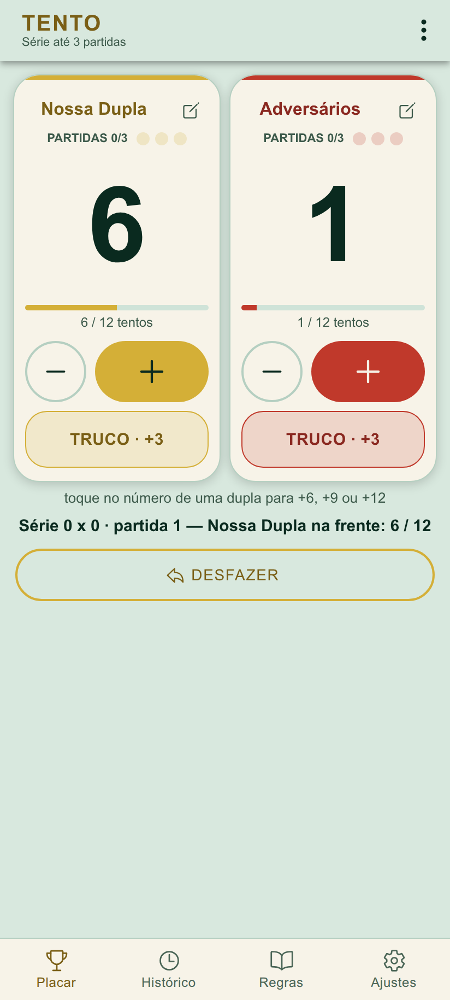
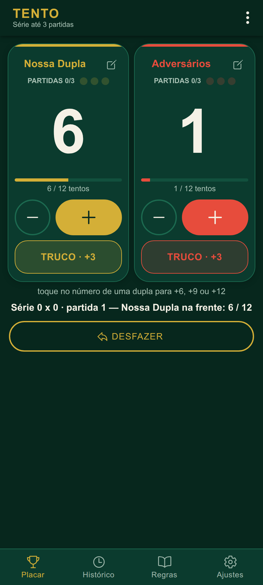
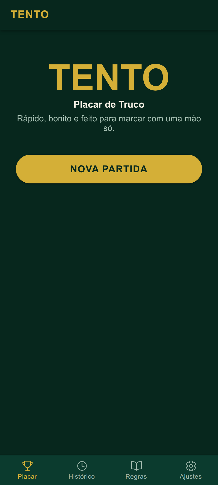
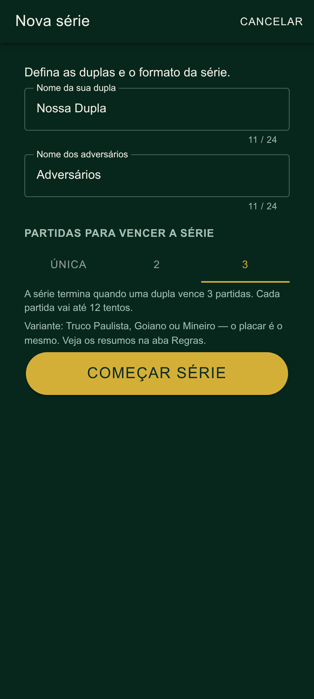
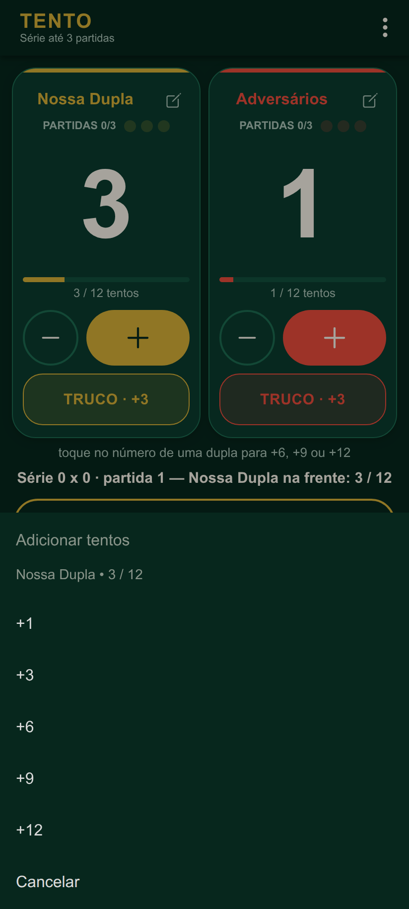
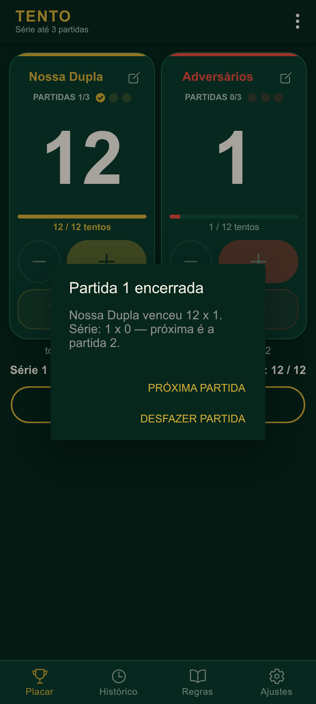
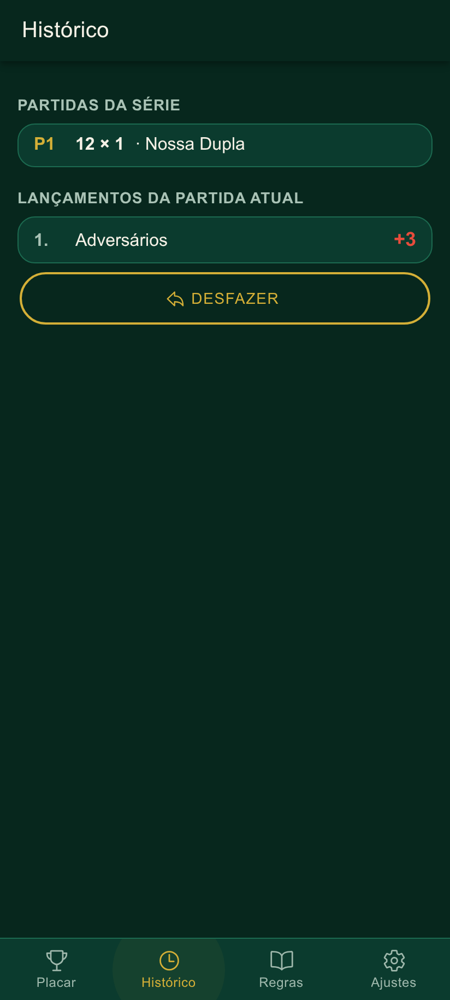
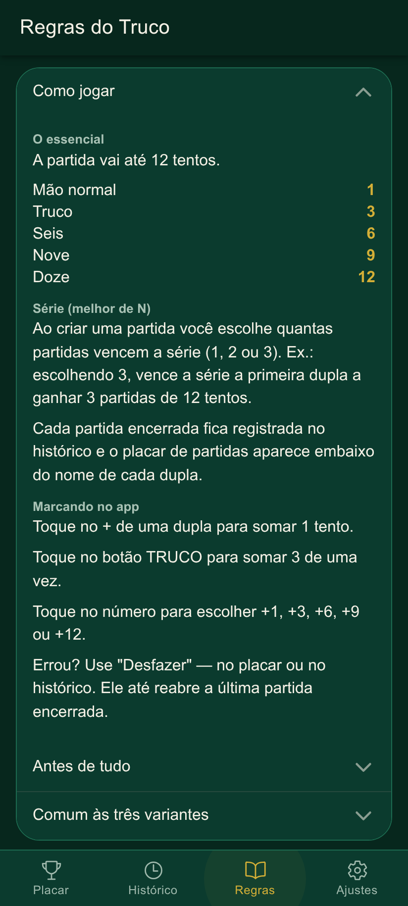
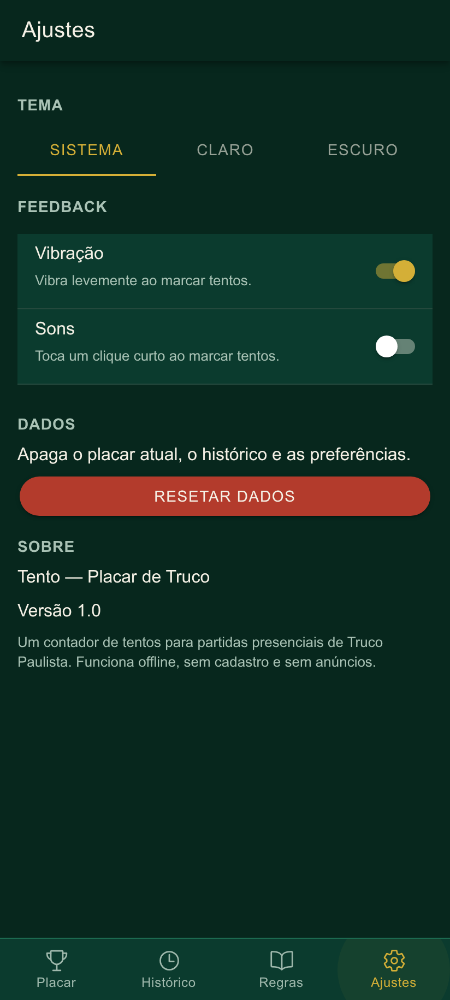

<div align="center">

# 🃏 Tento Ionic — Placar de Truco

**Contador digital de tentos para partidas presenciais de Truco, refeito em Ionic + React.**
Rápido, bonito e feito para marcar com uma mão só.


&nbsp;


</div>

---

## O que é

Port para **Ionic + React** do app Android nativo [**Tento**](https://github.com/KaioCastroXZ/Tento)
(Kotlin + Jetpack Compose), feito para a faculdade. Mantém as mesmas regras, a mesma
separação em camadas, a mesma identidade visual e os mesmos testes.

O app substitui o risquinho na mesa: ele **não** simula o jogo de cartas, não distribui
cartas e não joga contra o celular. A única função é **contar os tentos**, de forma que
dê para marcar em menos de um segundo, com o celular no centro da mesa.

### Recursos

- **Duas duplas** com nome editável (até 24 caracteres), placar gigante e progresso até 12.
- **Botão `TRUCO · +3`** dedicado, além de `−` / `+` e um menu rápido
  `+1 / +3 / +6 / +9 / +12` ao tocar no número (com confirmação se passaria de 12).
- **Série "melhor de N"**: vence quem ganhar primeiro **1, 2 ou 3** partidas de 12 tentos,
  com bolinhas (✓ nas vencidas) embaixo do nome de cada dupla.
- **Histórico** (partidas da série + lançamentos da partida atual) e **Desfazer** — que até
  reabre a última partida encerrada para corrigir um toque errado.
- **Persistência total**: fechou, reabriu, continua exatamente de onde parou.
- **Aba Regras** com "Como jogar" e os resumos de **Truco Paulista, Goiano e Mineiro**.
- **Tema Sistema / Claro / Escuro**, vibração e sons configuráveis, acessibilidade
  (`aria-label` nos botões, alvos ≥ 48 px, nada depende só de cor).
- **100% offline** — sem backend, sem login, sem cadastro, sem anúncios.

---

## Telas

| Início | Nova série | Menu rápido |
|:--:|:--:|:--:|
|  |  |  |

| Fim de partida | Histórico | Regras | Ajustes |
|:--:|:--:|:--:|:--:|
|  |  |  |  |

---

## Como a série funciona

| Formato | Vence a série quem… |
|--|--|
| **Única** | ganhar 1 partida de 12 tentos |
| **2** | ganhar 2 partidas primeiro |
| **3** (padrão) | ganhar 3 partidas primeiro |

- Ao chegar a 12, a partida é registrada no histórico e **continua à vista** até tocar em
  **"Próxima partida"**; enquanto isso, novos tentos são ignorados.
- **"Desfazer"** tem 3 casos: (1) partida encerrada à vista → apaga o registro dela e tira o
  último tento; (2) partida em andamento → desfaz o último lançamento; (3) partida atual
  zerada → **reabre a última partida encerrada** com o placar final dela.

---

## Tecnologias

- **Ionic Framework 9** + **React 19** + **TypeScript**, template `tabs` (`ionic start … tabs --type=react`)
- Roteamento do template (`@ionic/react-router` + `IonTabs`)
- **Capacitor 8** para rodar no Android: `@capacitor/preferences` (persistência, no lugar do
  DataStore) e `@capacitor/haptics` (vibração)
- **Vitest** (unidade) e **Playwright** (fluxo e prints)
- Sem Redux/Zustand: **React Context + hooks** bastam

## Arquitetura

```
src/
├── model/          tipos TS (port dos data classes) + helpers: winner, seriesWinner, scoreOf…
├── engine/         regra de negócio PURA e imutável — zero import de React/Ionic/Capacitor
│   ├── scoreEngine.ts    uma partida até 12
│   └── seriesEngine.ts   a série (melhor de N), compõe o scoreEngine
├── data/
│   ├── preferencesRepository.ts   salva/carrega série e ajustes em JSON, com sanitização
│   └── rulesContent.ts            textos das regras
├── hooks/
│   ├── ScoreProvider.tsx   Context: liga engine + persistência (papel do ScoreViewModel)
│   ├── useScore.ts · useTheme.ts · useFeedback.ts
├── theme/          variables.css (paleta clara/escura nas variáveis do Ionic) · teamColors.ts
├── components/     TeamPanel, AddPointsSheet, NewSeriesModal, HistoryList, SeriesDots…
└── pages/          Placar · Histórico · Regras · Ajustes
```

**Fluxo:** a UI nunca altera estado direto. Cada toque chama o `ScoreProvider`, que aplica
a função pura do `engine` sobre o estado anterior (atualização funcional, então toques
rápidos não perdem tentos), e um efeito grava o novo estado em JSON. A leitura inicial
sanitiza tudo (nomes vazios → padrão, placar entre 0 e 12, `gamesToWin` entre 1 e 3); JSON
corrompido começa do zero sem quebrar.

---

## Como executar

Pré-requisitos: Node.js + npm.

```bash
npm install
ionic serve                  # navegador (ou: npm run dev)
npm run test:unit            # testes de unidade (Vitest) — também vale: npm run test.unit -- --run
npm run test:e2e             # testes de fluxo (Playwright; 1ª vez: npx playwright install chromium)
npm run screenshots          # regenera os prints de docs/screenshots (não roda no test:e2e)
npm run lint                 # eslint + prettier + tipos
```

Para **ver os testes de fluxo rodando na tela**:

```bash
SLOWMO=500 npx playwright test e2e/app.spec.ts --headed --workers=1   # câmera lenta
npx playwright test --ui                                                # modo interativo
```

### Android (opcional)

```bash
ionic build
npx cap add android
npx cap sync android
npx cap open android         # abre no Android Studio
```

## Testes

`npm run test:unit` — **48 testes**:

| Arquivo | Cobre |
|--|--|
| `scoreEngine.test.ts` (22) | os 19 do original (começa 0×0, `+1/+3/+6/+9`, não passa de 12 e registra só a variação, não fica < 0, desfazer, resetar, vencedor, nomes, restaurar, sanear) + nome limitado a 24, tipos errados e time inválido |
| `seriesEngine.test.ts` (16) | os 16 do original (série zerada, partida à vista até avançar, pontos ignorados, série termina em N vitórias, partida única, os 3 casos de desfazer, resetar/nova série, sanear `gamesToWin`, restaurar) |
| `preferencesRepository.test.ts` (9) | round-trip, JSON corrompido, forma errada, valores inválidos, falha de leitura, `clearAll` |
| `App.test.tsx` (1) | abre na aba Placar com as 4 abas |

`npm run test:e2e` — **9 testes de fluxo** num Chrome mobile (Pixel 7): tela inicial e abas;
marcar/truco/remover, persistência ao recarregar, menu rápido com confirmação acima de 12 (cancelar
e aplicar), fim de partida, desfazer e reabrir; partida única; série até 2; partida reaberta
(+/TRUCO desabilitados); edição de nome; Zerar; tema escuro, Regras e Resetar dados.

Todo teste de fluxo tem um **guarda automático** (`e2e/fixtures.ts`): ao final, o console não pode ter
warnings nem erros e o app não pode ficar com `aria-hidden` preso (bug clássico ao encadear overlays do
Ionic, que esconde a tela de leitores de tela). Esse guarda já pegou dois bugs reais durante o
desenvolvimento.

## Diferenças em relação ao app Android

- **Sem o "+N" flutuante** que aparecia sobre o número e **sem o fio divisor central** entre os dois
  painéis do Compose; o "pulso" de escala do número foi mantido.
- **Textos de "Como jogar"** ajustados ao app: sem a menção ao toque longo no `+` e com "Desfazer" no
  placar ou no histórico.
- **Partida reaberta pelo Desfazer** (12 × N sem registro): `+`/`TRUCO`/menu rápido ficam desabilitados
  (o engine ignora tentos nesse estado) e o `−` só vale na dupla que está com 12.
- **Desfazer no fim de série** (e de partida única): o alerta oferece `Desfazer` no lugar do
  `Ver placar`/`Continuar` do original — assim o placar nunca fica "congelado".
- **`−` desabilitado** com a partida fechada em 12 à vista. O engine é idêntico ao Kotlin, e lá
  `removePoint` nesse momento deixaria o resultado registrado e contaria a partida em dobro;
  a UI evita o caso.
- **Sem toque longo no `+`** (o menu rápido é pelo toque no número).
- Telas "Início", "Como jogar" e "Regras" viraram abas / seções da aba Regras.
- O script de testes do template se chama `test:unit` (não `test.unit`).
- Sem serialização `ScoreHistoryCodec`/`GameResultCodec`: a persistência usa JSON.

## Limitações conhecidas

- Em tela larga o placar só centraliza (largura máxima de 720 px); não há layout dedicado de 3 colunas.
- Os sons são um clique sintetizado (WebAudio), sem trilha própria.
- O projeto Android (`npx cap add android`) não vem versionado: é gerado com os comandos acima.

---

<div align="center">
<sub>Feito com Ionic + React. Sem backend, sem login, sem anúncios.</sub>
</div>
